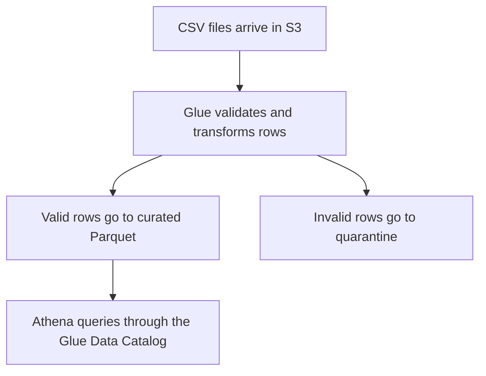

# Start here

[Home](README.md) · [Topic index](topic-guides/README.md) · [Diagnostic](practice/diagnostic.md)

A data pipeline moves data from where it is produced to where people can use it. Picture a lab that receives one CSV per sequencing run. The lab stores the original files, checks that each sample has a run ID, and publishes a cleaned table that analysts can query.

| Term | In the lab example |
|---|---|
| Batch | Process a group of files together, such as all runs from yesterday |
| Stream | Process a continuing flow of events as they arrive |
| ETL | Extract data, transform it in a processing engine, then load the result |
| ELT | Load data first, then transform it in the destination |
| Data lake | Store source and curated datasets in an object store such as S3 |
| Warehouse | Store and query structured analytical tables in a system such as Redshift |
| Catalog | Describe where the data lives, what columns it has, and how to read it |
| Partition | Group rows by a value such as run date so a query can skip unrelated files |
| CDC | Capture inserts, updates, and deletes from a source database over time |
| Idempotency | Rerun the same work and reach the same final result |
| Backfill | Reprocess a past period to fill a gap or apply a correction |
| Schema drift | A source changes its fields or types, such as an integer arriving as text |

Know basic SQL filters, joins, aggregation, and window functions. If AWS is new to you, learn what an S3 bucket, IAM role, and CloudWatch log group do before starting the first week.

**Recall check.** If the curated Parquet objects exist in S3 but Athena has no table definition, which layer is missing? The metadata layer. The data and its catalog entry are separate.

Next → [Four-week plan](learning-paths/4-week-plan.md)

## Terms that come up in scenarios

| Term | Plain-English meaning |
|---|---|
| Consumer lag | How far a reader is behind the newest records available in a stream |
| Fan-out | Give more than one consumer its own copy or read path for an event feed |
| Checkpoint | A durable record of progress used to resume processing |
| Grain | What one row represents, such as one sample per day |
| Data skew | An uneven distribution of records or work, such as one device generating most of the events |
| Partition pruning | Skip file groups whose partition values cannot match the query |
| Column pruning | Read only the columns the query needs from a suitable format |
| Schema | The expected fields, types, and structure of a dataset |
| Lineage | The record of where data came from and how it changed |
| Materialized view | Stored results of a query that are refreshed according to the engine’s supported behavior |
| Dead-letter queue | A destination for messages that failed processing repeatedly |
| Data residency | Where data and its copies are physically stored |
| Least privilege | Give an identity only the access needed to do its job |
| Embedding | A numeric representation used to compare the similarity of items |
