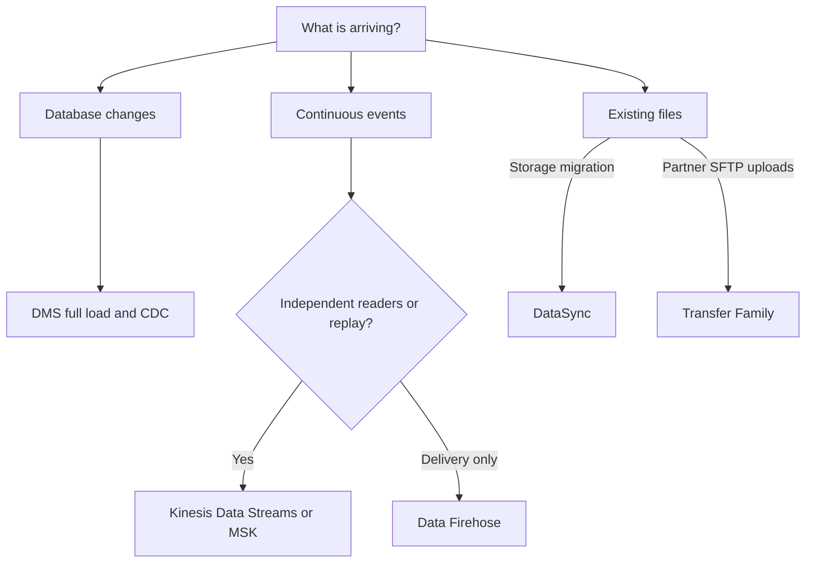
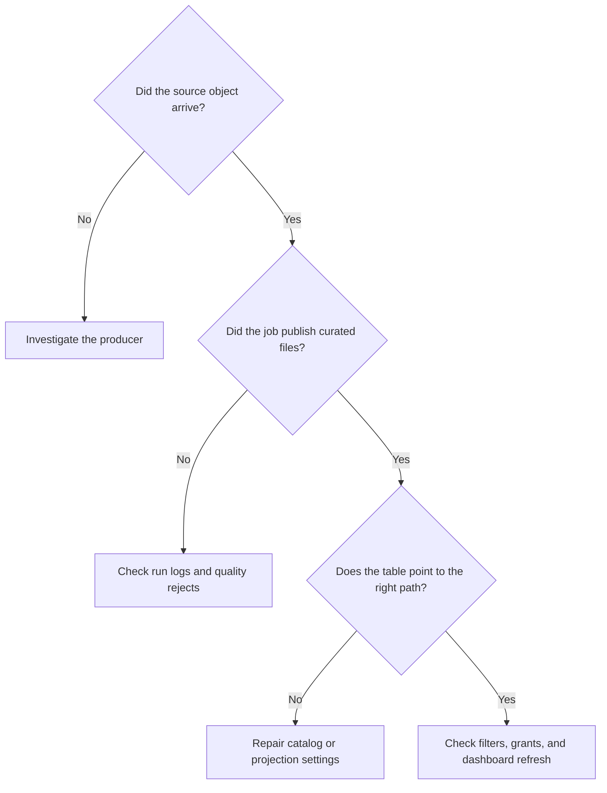
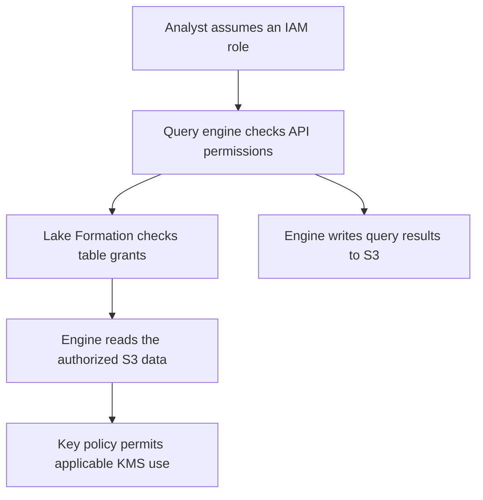

# Visual decision maps

[Home](../README.md) · [Service decisions](README.md)

## Choose the ingestion layer

An existing stream can feed Firehose and a stateful processor at the same time. Use [streaming](../topic-guides/streaming.md) and [data movement](../topic-guides/data-movement.md) to compare the edges of each choice.

## Diagnose a missing partition

Trace one missing day or batch all the way through. [Monitoring guide](../topic-guides/monitoring.md)

## Trace access to a governed table

The exact credential and key path depends on the service integration. Test the analyst role and verify that direct reads of the raw objects follow the intended policy. [IAM guide](../topic-guides/security.md) · [Governance guide](../topic-guides/governance.md)
