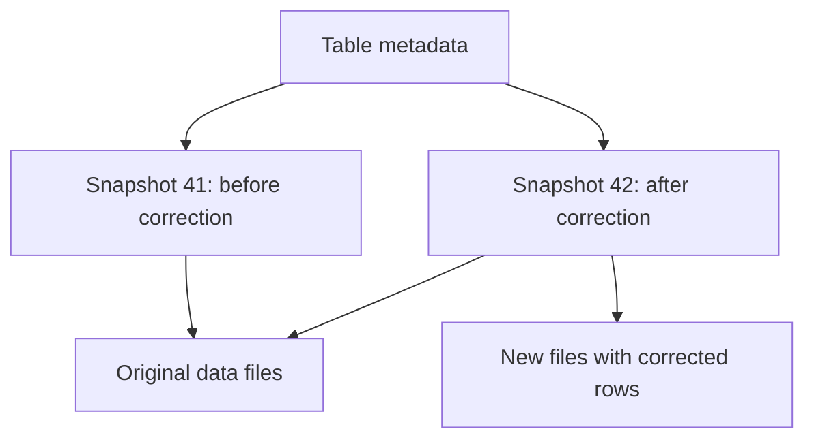

# Apache Iceberg, open table formats, and Amazon S3 Tables

[Topic index](README.md) · [Exam map](../EXAM-MAP.md)

## The idea

Parquet files are pages. Apache Iceberg is the edition record that says which pages make up the current version of the book. Every write produces a new **snapshot**, a list of the files that form the table at that moment. Engines read a snapshot, so a reader never sees a half-finished write.

An **open table format** is a metadata layer over ordinary data files that adds transactions, row-level changes, schema evolution, and time travel. Iceberg is the one the exam names. Delta Lake and Apache Hudi solve the same problem.

## What Iceberg adds over plain Parquet

| Capability | Plain Parquet folder | Iceberg table |
|---|---|---|
| Atomic writes | A reader can see partial output | Readers see the old or new snapshot, never a mix |
| Update or delete rows | Rewrite the whole partition yourself | `MERGE`, `UPDATE`, and `DELETE` in Athena, Spark, and Redshift |
| Time travel | Not available | Query `FOR TIMESTAMP AS OF` or `FOR VERSION AS OF` while the snapshot is retained |
| Schema evolution | Readers break on renamed or reordered columns | Add, drop, rename, and reorder columns by column ID |
| Partition evolution | Rewrite data to change partitioning | Change the partition spec. Old files keep their layout |
| Hidden partitioning | Queries must filter on a separate partition column | Partition on a transform such as `day(event_time)`. Queries filter on `event_time` |

## Iceberg maintenance and Amazon S3 Tables

Every write adds files and snapshots. Without maintenance, small files and old snapshots pile up.

| Task | Athena command | Effect |
|---|---|---|
| Compaction | `OPTIMIZE runs REWRITE DATA USING BIN_PACK` | Rewrites small files and merges delete files into larger data files |
| Snapshot expiration and orphan cleanup | `VACUUM runs` | Removes snapshots older than the retention setting and files no snapshot references |
| Set retention | `ALTER TABLE runs SET TBLPROPERTIES ('vacuum_max_snapshot_age_seconds'='259200')` | Keeps three days of snapshots for time travel |

After `VACUUM`, expired snapshots can no longer be queried with time travel. Set retention to cover the audit window first.

Managed options remove the manual schedule:

- **Glue Data Catalog table optimizers** run compaction, snapshot retention, and orphan file deletion for Iceberg tables registered in the catalog.
- **Amazon S3 Tables** store Iceberg tables in a **table bucket**. S3 runs compaction, snapshot management, and unreferenced file removal automatically, and you tune the settings per table or bucket. Tables are grouped in namespaces. Access is managed with the `s3tables` IAM namespace and Lake Formation. Integrate the table bucket with the Glue Data Catalog so Athena, Redshift, EMR, and Glue can query it.

| Choose | When |
|---|---|
| Iceberg in a general purpose bucket, maintained with Athena or Spark | You need full control of layout and maintenance timing |
| Iceberg with Glue table optimizers | You want managed maintenance for tables already in a general purpose bucket |
| Amazon S3 Tables | New tabular datasets where you want S3 to run maintenance and enforce table-level access |

## Locking and concurrent writers

Iceberg uses optimistic concurrency. Two writers each prepare a new snapshot. The first to commit wins. The second detects the conflict and retries on top of the new snapshot, or fails if the changes overlap. The catalog performs the atomic swap of the current-snapshot pointer, so every writer must use the same catalog.

## Numbers and defaults

| Fact | Value | Why it matters | AWS source |
|---|---|---|---|
| Snapshot retention property in Athena | `vacuum_max_snapshot_age_seconds` | Controls how far back time travel reaches after `VACUUM` | [Athena Iceberg optimization](https://docs.aws.amazon.com/athena/latest/ug/querying-iceberg-data-optimization.html) |
| S3 Tables maintenance | Compaction, snapshot management, and unreferenced file removal run automatically | No maintenance jobs to schedule | [S3 Tables](https://docs.aws.amazon.com/AmazonS3/latest/userguide/s3-tables.html) |
| S3 Tables public access | Block Public Access is always on for table buckets | Removes one misconfiguration risk | [S3 Tables](https://docs.aws.amazon.com/AmazonS3/latest/userguide/s3-tables.html) |

## Common mistake

Running `VACUUM` with a short retention on a table that auditors query with time travel. The snapshots they need disappear.

## Commonly confused

| Choices | Deciding requirement |
|---|---|
| Parquet vs. Iceberg | File format vs. table metadata over files |
| `OPTIMIZE` vs. `VACUUM` | Rewrites small files vs. expires snapshots and deletes orphan files |
| S3 Tables vs. Iceberg in a general purpose bucket | Managed maintenance and table-level access vs. full control |
| Iceberg time travel vs. S3 versioning | Query a past table state vs. recover a past object version |

**Exam cues:** "Row-level updates on S3 data", "ACID", "time travel", "schema evolution without rewriting" → Iceberg. "Least operational overhead for table maintenance" → S3 Tables or Glue table optimizers.

## Try it

A lake table on S3 receives daily corrections by sample ID. Auditors need to query the table exactly as it was 30 days ago. Queries slow down over time because of small files.

Show the reasoning

Store it as an Iceberg table and apply corrections with `MERGE`. Set snapshot retention above 30 days. Schedule `OPTIMIZE`, or use S3 Tables or Glue table optimizers for managed compaction. Test a time-travel query for a date 30 days back.

## AWS documentation

- [Query Iceberg tables in Athena](https://docs.aws.amazon.com/athena/latest/ug/querying-iceberg.html)
- [Optimize Iceberg tables in Athena](https://docs.aws.amazon.com/athena/latest/ug/querying-iceberg-data-optimization.html)
- [Glue table optimizers](https://docs.aws.amazon.com/glue/latest/dg/table-optimizers.html)
- [Amazon S3 Tables](https://docs.aws.amazon.com/AmazonS3/latest/userguide/s3-tables.html)

*Last verified against AWS documentation: November 2026.*
