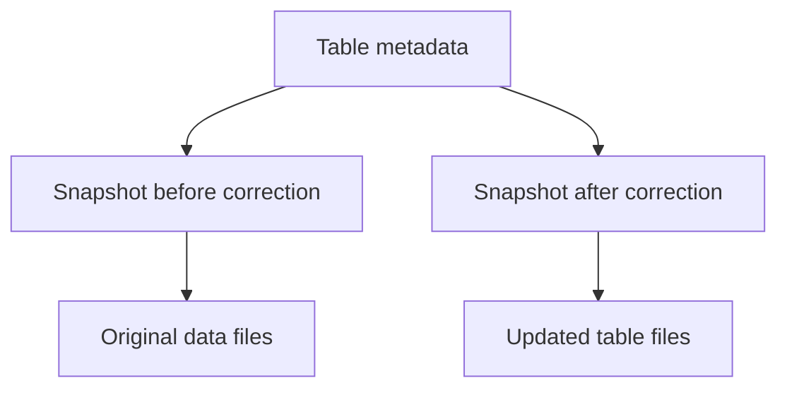

# Iceberg and open table formats

[Topic index](README.md) · [Exam map](../EXAM-MAP.md)

Think of Parquet as pages and Iceberg as an edition manifest. Parquet encodes columns in each file. Iceberg metadata describes which files form a committed version of the table. Engines that understand that metadata can query the table consistently as data changes.

| Feature | What it means in practice |
|---|---|
| Snapshot | Represents a committed table state and supports time travel where the engine allows it |
| Schema evolution | Evolve supported fields through table metadata. Confirm engine restrictions before changing types or renaming columns |
| Partition evolution | Update the partition spec as query patterns change. Existing files can keep their original layout |
| Compaction | Rewrite small files into fewer files to reduce planning and read overhead |
| Snapshot expiration and orphan cleanup | Reclaim storage according to retention rules. Expired snapshots can no longer support time travel |

In Athena, `OPTIMIZE` can compact an Iceberg table and `VACUUM` performs snapshot expiration and orphan file cleanup. Confirm your retention requirements before applying cleanup. Check engine support, catalog setup, and permissions before adopting a feature.

**Scenario.** An analytics table on S3 receives daily corrections by ID, and auditors need yesterday’s view. Evaluate Iceberg with supported row-level operations and time travel. Keep snapshots for the required window. A Parquet-only export can be efficient for immutable batches, but it gives you no Iceberg snapshot history by itself.

[Athena Iceberg support](https://docs.aws.amazon.com/athena/latest/ug/querying-iceberg.html) · [Athena Iceberg maintenance](https://docs.aws.amazon.com/athena/latest/ug/querying-iceberg-data-optimization.html)
