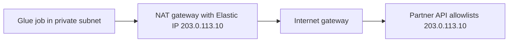

# Networking for data pipelines: security groups, endpoints, and allowlists

[Topic index](README.md) · [Exam map](../EXAM-MAP.md)

## The idea

Permissions decide whether a call is *allowed*. The network decides whether it can *arrive*. An access problem returns `AccessDenied`. A network problem usually shows up as a **timeout**. If a job times out connecting to a database, look at the network path before touching credentials.

## Security groups for private database access

A **security group** is a stateful firewall attached to network interfaces. It allows traffic. It has no deny rules.

| Source | Target | Rule on the target's security group |
|---|---|---|
| Glue job with a VPC connection | RDS PostgreSQL | Inbound TCP 5432 from the Glue connection's security group |
| Lambda in a VPC | Redshift | Inbound TCP 5439 from the Lambda function's security group |
| Glue job (any) | Itself | Glue requires a self-referencing inbound rule on all TCP ports for its workers to talk to each other |

Reference security groups instead of IP ranges where possible. Network ACLs are stateless subnet-level filters and rarely the cause in exam scenarios, but check them when security groups look correct.

## Source allowlists and network paths

An **allowlist** limits connections to known IP addresses. Two directions come up.

**A partner's API allowlists your traffic.** Lambda functions and Glue jobs in private subnets have no fixed public IP. Route their outbound traffic through a **NAT gateway** with an **Elastic IP address**, and give the partner that one address.

**Your database allowlists a service.** An RDS or Redshift security group can allow inbound traffic from a known CIDR range, such as an on-premises network over AWS Direct Connect or VPN. Some AWS services that connect from outside your VPC publish IP ranges per Region in `ip-ranges.json`. Prefer private connectivity where the service supports it.

## Access points, gateway endpoints, and PrivateLink

Traffic from a private subnet to S3 or other AWS APIs can stay on the AWS network through **VPC endpoints**.

| Endpoint type | Services | Cost and setup | Notes |
|---|---|---|---|
| Gateway endpoint | Amazon S3 and DynamoDB only | No hourly charge. Added as a route in the route table | Most common exam answer for "private subnet reads S3 without a NAT gateway" |
| Interface endpoint (AWS PrivateLink) | Most AWS services, such as Glue, KMS, Secrets Manager, CloudWatch Logs, Kinesis, and also S3 | Hourly and data charges. Creates network interfaces in your subnets with private IPs | Reachable from on premises through Direct Connect or VPN |

**Endpoint policies** limit which resources can be reached through an endpoint. **Bucket policies** can require that requests arrive through a specific endpoint with the `aws:SourceVpce` condition.

**S3 Access Points** give a named entry point to a bucket with its own policy. Create one per team or application instead of one huge bucket policy. An access point can be restricted to a single VPC.

## Shared responsibility across deployment models

The less you manage, the less you secure yourself.

| Model | AWS manages | You manage |
|---|---|---|
| Unmanaged: database on EC2 | Hardware, hypervisor, data center | OS patches, database patches, backups, high availability, encryption setup |
| Managed: Amazon RDS | Above plus OS and database patching, automated backups, Multi-AZ failover | Schema, users and grants, security groups, encryption choices, parameter tuning |
| Serverless: Athena, Glue, DynamoDB | Above plus capacity and servers | Data, IAM permissions, encryption keys, network access settings |

"Least operational overhead" in a question usually points to the managed or serverless option.

## Numbers and facts

| Fact | Value | Why it matters | AWS source |
|---|---|---|---|
| Gateway endpoint services | S3 and DynamoDB | Every other service needs an interface endpoint | [Gateway endpoints](https://docs.aws.amazon.com/vpc/latest/privatelink/gateway-endpoints.html) |
| Glue connection security group | Needs a self-referencing inbound rule for all TCP ports | Missing rule causes Glue connection test failures | [Glue VPC setup](https://docs.aws.amazon.com/glue/latest/dg/setup-vpc-for-glue-access.html) |
| Security groups | Stateful, allow rules only | Return traffic is allowed automatically | [Security groups](https://docs.aws.amazon.com/vpc/latest/userguide/vpc-security-groups.html) |

## Common mistake

Rotating credentials because a Glue job "can't connect" when the error is a timeout. Credentials errors are rejected quickly. Timeouts mean the packets never arrived.

## Commonly confused

| Choices | Deciding requirement |
|---|---|
| Gateway vs. interface endpoint | S3 or DynamoDB at no hourly cost vs. any other service, or access from on premises |
| NAT gateway vs. VPC endpoint | Reach the internet with a fixed IP vs. reach AWS services privately |
| Security group vs. network ACL | Stateful allow rules on interfaces vs. stateless allow and deny rules on subnets |
| Access point vs. bucket policy | Per-application entry with its own policy vs. one policy for the whole bucket |

**Exam cues:** "Partner requires a static IP" → NAT gateway with Elastic IP. "Private subnet, no internet, read S3" → S3 gateway endpoint. "Only through our VPC" → `aws:SourceVpce` condition. "Connection timed out" → security groups, routes, DNS.

## Try it

A Glue job in a private subnet must read from RDS in the same VPC, write to S3, and call a partner API that allowlists one IP address. There is no internet access today.

Show the reasoning

Add inbound 5432 on the RDS security group from the Glue security group, plus Glue's self-referencing rule. Add an S3 gateway endpoint for S3 writes. Add a NAT gateway with an Elastic IP in a public subnet, route the private subnet's internet traffic through it, and give the partner that IP.

## AWS documentation

- [Gateway endpoints](https://docs.aws.amazon.com/vpc/latest/privatelink/gateway-endpoints.html)
- [What is AWS PrivateLink?](https://docs.aws.amazon.com/vpc/latest/privatelink/what-is-privatelink.html)
- [Setting up a VPC for Glue](https://docs.aws.amazon.com/glue/latest/dg/setup-vpc-for-glue-access.html)
- [NAT gateways](https://docs.aws.amazon.com/vpc/latest/userguide/vpc-nat-gateway.html)
- [S3 Access Points](https://docs.aws.amazon.com/AmazonS3/latest/userguide/access-points.html)

*Last verified against AWS documentation: November 2026.*
